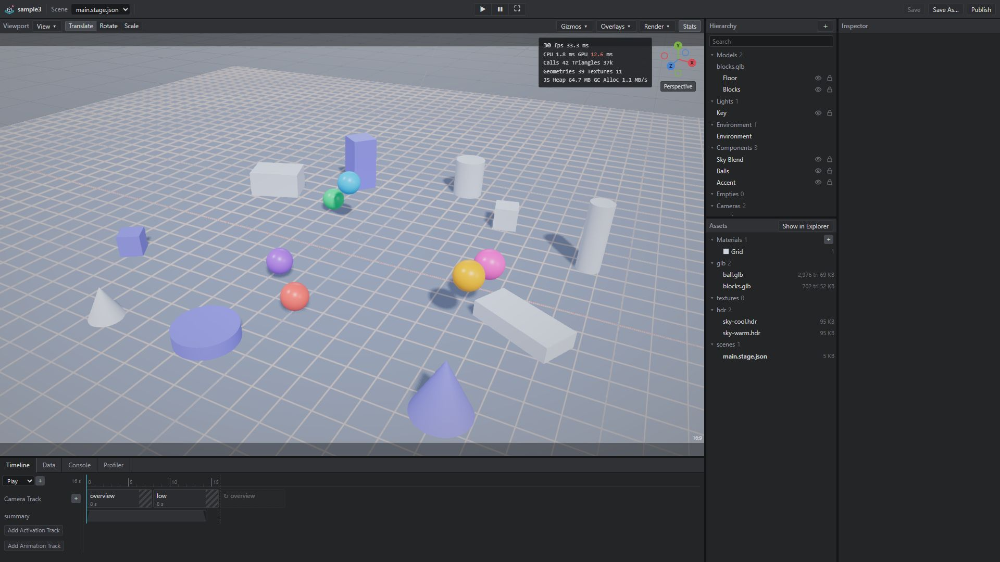

# THREE Stage

THREE Stage is a desktop application for building 3D scenes for websites and web applications with three.js.
You place glTF models, set up materials, lighting, cameras and effects, and connect the scene to data supplied by your web application.
The finished scene is exported as a React component that any web application can embed.



## Features

- **Scene editing** — Place glTF (`.glb`) models and adjust their position, materials, lights, environment lighting (HDRI), fog, tone mapping, shadows and post-processing in the Inspector, with undo.
- **Camera work and timelines** — Arrange cameras on a looping Timeline with blends between shots, and control when objects and 2D UI elements are visible. Animation clips contained in glTF files can be played on the Timeline.
- **Data-driven scenes** — Bind values from your application's data to component, shader and post-effect parameters. Play back mock data at any time of day and speed while editing.
- **Events** — Play one-shot Timelines when the data changes, or trigger them by name from your web application.
- **Custom code** — Write components (React Three Fiber), GLSL shaders, post effects, triggers and camera motions in TypeScript inside the project. They appear in the editor alongside the built-in ones.
- **Consistent rendering** — The editor renders with the same runtime that the exported component uses, so the scene looks and behaves the same in the editor and in your application.
- **Performance tools** — Frame time, CPU and GPU time, draw calls, triangles and memory are shown over the viewport. Command-line tools take screenshots, measure frame times, and run long memory tests in headless Chrome.

## How it works

| Step | Where | Result |
|---|---|---|
| Create a project | Editor or `three-stage new` | A folder with scene files (`content/`) and TypeScript code (`src/`) |
| Build the scene | Editor | Scene definition files (`*.stage.json`) |
| Publish | Editor or `three-stage publish` | A scene bundle: the scene definitions and assets, ready to be served |
| Package | `three-stage build` | A React component package (`.tgz`) that renders the bundle |
| Embed | Your web application | `<MyStage bundle="/stage/manifest.json" data={data} />` |

A project contains only its own files. React, three.js and the runtime are provided by the application, so a project has no `node_modules`.

## Requirements

| Item | Requirement |
|---|---|
| OS | Windows 11 |
| Node.js | 22 or later, to build the installer |
| Chrome | Required only for the command-line performance tools |

The web application that embeds the exported component installs its peer dependencies: React 19, three.js r186, React Three Fiber 9 and drei 10.

## Installation

No prebuilt installer is distributed. Build it from this repository:

```powershell
npm install
npm run release
```

Run the generated `dist/release/dist/THREE-Stage-Setup-<version>.exe`.
After the application has been started once, the `three-stage` command is available in Command Prompt and PowerShell.

## Getting started

1. Start THREE Stage and choose **New Project**. Select the **Sample** template to start from a working scene.
2. Add your own `.glb` files by dropping them onto the Assets panel, then drag them into the viewport.
3. Press **Play** to preview the scene with mock data, then **Publish** to export the scene bundle.
4. Run `three-stage build <project folder>` to create the React component package for your web application.

See [Getting started](docs/getting-started.md) for details.

## Documentation

The documentation is written in Japanese.

| Document | Contents |
|---|---|
| [Getting started](docs/getting-started.md) | Installation, projects, commands, and the basic workflow |
| [Studio](docs/studio.md) | The editor's panels and operations, Scenes and Timelines |
| [Scripting](docs/scripting.md) | Writing components, shaders, post effects, triggers, camera motions and 2D UI |
| [Scene format](docs/scene-format.md) | The scene definition format, Publish output, and embedding in a web application |
| [Performance](docs/performance.md) | Performance targets, measurement, and optimization |

## Development

```powershell
npm install
npm run app
```

`npm run app` starts the editor from the source tree.

| Command | Description |
|---|---|
| `npm run typecheck` | Type-checks the runtime and the editor |
| `npm test` | Runs the end-to-end tests in headless Chrome (see [packages/studio/test](packages/studio/test/README.md)) |
| `npm run release` | Builds the installer |

| Package | Description |
|---|---|
| [`@three-stage/runtime`](packages/runtime) | Loads a scene definition and renders it. Used by both the editor and the exported component |
| [`@three-stage/studio`](packages/studio) | The editor, the `three-stage` command, project templates, and the performance tools |

The packages are not published to npm.

## License

[MIT](LICENSE)
